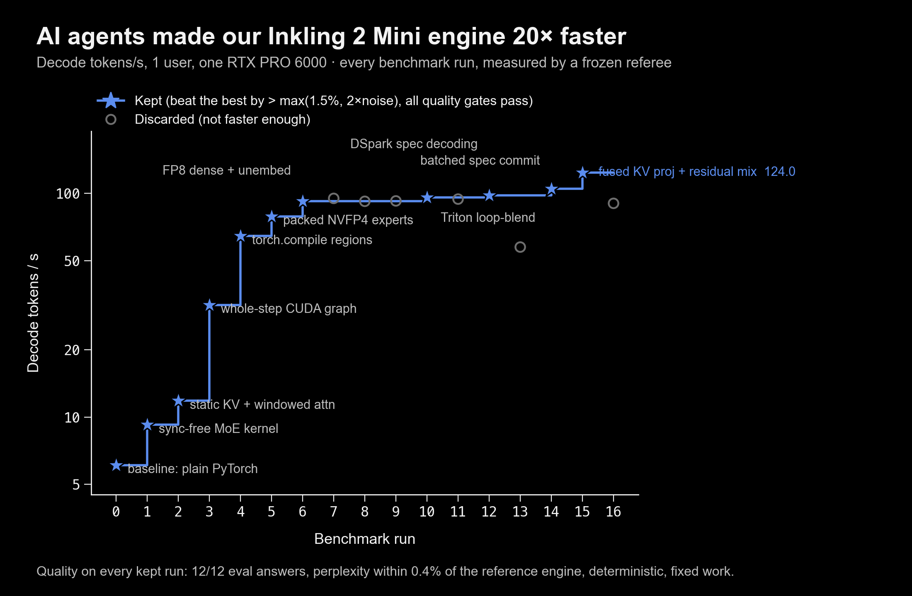
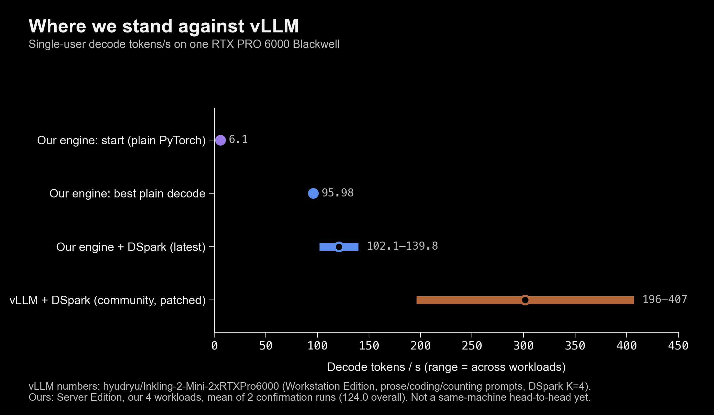
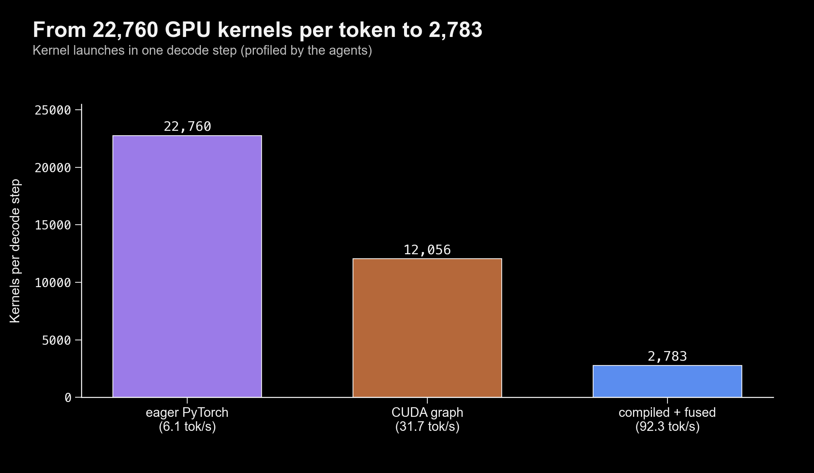
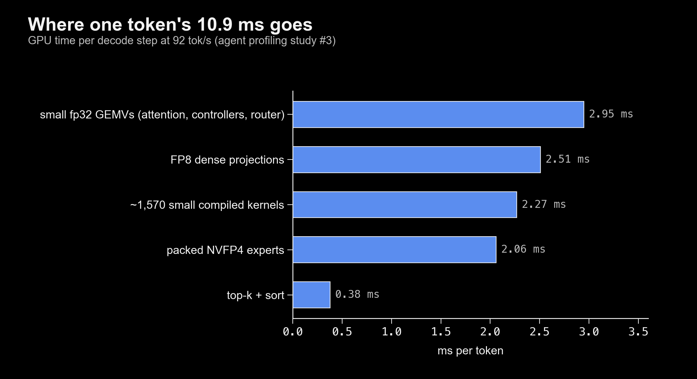
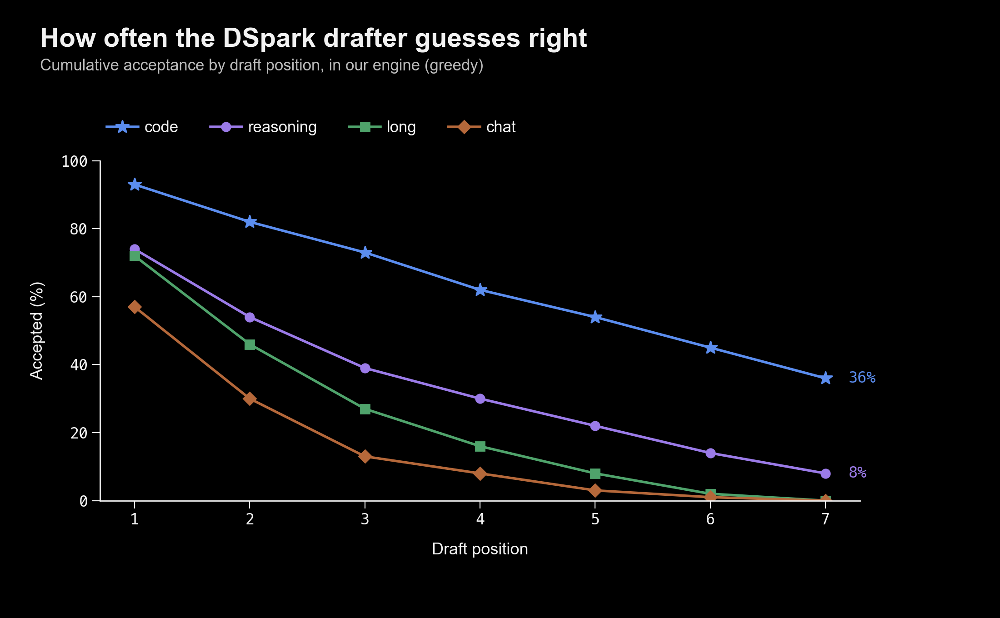
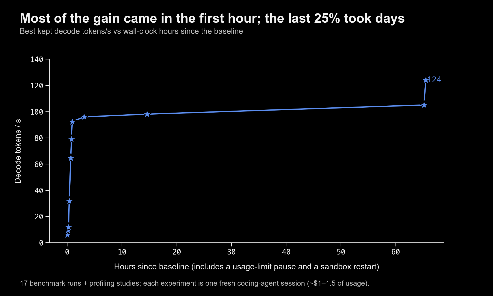

# auto-inference-gpu

**AI agents wrote and optimized an inference engine for a model released the day before.**
Our own engine for [Inkling 2 Mini](https://huggingface.co/thinkingmachines/Inkling-2-Mini) (Thinking Machines, 26.4B looped MoE,
Apache 2.0) on one NVIDIA RTX PRO 6000 Blackwell, made **20× faster** by an autoresearch loop: Claude Code agents propose one change
at a time, a frozen referee measures it, and only real, quality-preserving speedups are kept.



| | |
|---|---|
| **Start** (plain PyTorch, correct, slow) | 6.1 tokens/s |
| **After autoresearch** | **124.0 tokens/s (20.3×)**, mean of 2 confirmation runs (120.5 / 127.6) |
| **Quality on every kept step** | 12/12 eval answers, perplexity within 0.4% of the reference engine, deterministic, fixed work |
| **Runtime dependencies** | PyTorch + Triton only (no vLLM / SGLang) |
| **Experiments** | 17 benchmark runs + ~15 profiling studies, one fresh coding-agent session each (~$1–1.5 of agent usage per experiment) |

## What the agents did (every step is a git commit + a measured run)
| # | Kept change | tok/s | What it taught |
|---|---|---|---|
| 0 | Baseline: engine v1, eager PyTorch | 6.1 | GPU idle ~70%: 22,760 kernels and 480 host syncs per token |
| 1 | Sync-free MoE: Triton grouped GEMV over the top-8 experts | 9.2 | `.unique().tolist()` per layer = 432 CPU↔GPU syncs per token |
| 2 | Static K/V buffers + windowed attention for one token | 11.8 | no `torch.cat` reallocations; local layers only need 1,024 keys |
| 3 | **Whole decode step in one CUDA graph** | 31.7 | launch cost 22 µs → ~1 µs per kernel |
| 4 | `torch.compile` of the small per-token ops inside the graph | 64.5 | 65% of the step was 11,500 tiny kernels |
| 5 | Packed NVFP4/MXFP8 experts, unpacked inside a Triton kernel | 79.0 | experts read 3.4× fewer bytes, bit-identical to the BF16 path |
| 6 | FP8 dense projections + FP8 output layer (gated by quality) | 92.3 | a lever vLLM doesn't use; NLL ratio 0.9964 |
| 7 | Loop-message blend in 3 Triton kernels | 96.0 | small matmuls are latency-bound, not bandwidth-bound |
| 8 | DSpark speculative decoding, fully CUDA-graphed (draft + verify + commit on GPU) | 98.1 | 2.3–2.9 tokens/step, but a verify step still cost ~2.2× a normal one |
| 9 | Batched speculative commit: conv history + KV ring in 2 kernels instead of ~624 | 105.1 | the commit, not the drafter, was eating the speculative gain |
| 10 | Fused KV projections + residual mixing, FP4 expert accumulation, compiled drafter | **124.0** | 3-row KV projection 28.4 → 14.3 µs; confirmed control → candidate → candidate → control |

Discarded experiments are kept on `discarded/*` branches: an FP8 GEMV retune, a fused split-key attention kernel, three designs
for reading each expert once across draft tokens (all slower: expert time is latency/dequant-bound on this GPU), and more.

## Where we stand


- **One forward pass costs about the same as vLLM's** (~10 ms) on this GPU family.
- **Ours with DSpark: 102–140 tok/s by workload (124.0 overall).** Same card, a C++/CUDA engine (ninfer, ~4-bit weights) reports 156 plain / 207 with DSpark.
- **vLLM + DSpark reaches 196–407 tok/s** (community measurement, [hyudryu/Inkling-2-Mini-2xRTXPro6000](https://github.com/hyudryu/Inkling-2-Mini-2xRTXPro6000),
  Workstation Edition, different prompts). Our speculative step overhead is the remaining gap. This is **not yet a same-machine head-to-head**.
- Not covered by our benchmark (yet): prefill speed, long context, many concurrent users.

<p> </p>
<p> </p>

## How the autoresearch works
```
  program.md + knowledge/ + CHECKLIST.md          (the brief: GPU facts, model op graph, measured numbers, dead ends)
          │
          ▼
  fresh Claude Code agent ──► profiles on the GPU ──► edits engine/ ──► git commit
          │                                                   │
          │                                                   ▼
          │                               run_remote.sh → prepare_gpu.py on the GPU (frozen referee)
          │                               external timing · fixed work · golden-output quality gates
          │                                                   │
          ▼                                                   ▼
  notes.md (shared memory)  ◄──────────  decide.py: KEEP if faster than best × (1 + max(1.5%, 2×noise)), else revert
```
- **The referee can't be fooled**: speed is timed outside the engine, outputs must have exactly the requested length, quality
  is checked against outputs saved once from a frozen reference engine (`ref/`, `golden/`).
- **One experiment per fresh agent**; memory lives in files; the loop itself reverts anything not kept and saves it on a branch.
- **`CHECKLIST.md`** maps 28 optimization dimensions (formats, KV cache, speculation, kernels, sparsity, storage, NPU,
  test-time compute, energy…) with "applies when" rules and a coverage table. **`PRODUCT.md`** is the plan to generalize this
  to any model on any local hardware.

## Repository
| Path | What |
|---|---|
| `engine/` | the optimized engine (what the agents edit) |
| `ref/`, `golden/` | frozen reference engine + golden outputs |
| `prepare_gpu.py`, `decide.py`, `run_remote.sh`, `loop.sh` | referee, decision, remote runner, agent loop |
| `program.md`, `knowledge/`, `CHECKLIST.md` | the agents' brief |
| `reference/` | read-only DSpark reference code from vLLM PR #69028 (Apache-2.0) |
| `launch/` | charts (`charts.py` regenerates them from `research/results.tsv`) |

## Run it
Needs one NVIDIA GPU with ≥ 80 GB (developed on an RTX PRO 6000, sm_120), PyTorch ≥ 2.11 + Triton ≥ 3.6, and the checkpoint:
```bash
hf download thinkingmachines/Inkling-2-Mini --local-dir /tmp/inkling
python prepare_gpu.py              # benchmark the current engine (prints RESULT {...})
python prepare_gpu.py golden       # regenerate golden outputs from ref/
```
The agent loop (`./loop.sh N`) drives a remote GPU from a laptop through `tools/molab.sh`; adapt it to SSH for your own machine.

## Sibling project
The same method on a laptop (Apple M1 Pro, MLX): [auto-inference-mlx](https://github.com/Sankalpcreat/auto-inference-mlx).

## Credits
- [Thinking Machines Lab](https://thinkingmachines.ai) for Inkling 2 Mini and its DSpark drafter (Apache 2.0).
- vLLM PR #69028 (Woosuk Kwon et al.) as the read-only math reference; no vLLM code runs in the engine.
- [karpathy/autoresearch](https://github.com/karpathy/autoresearch) for the loop idea; [Auto-Inference-Optimiser](https://github.com/manthanguptaa/Auto-Inference-Optimiser) for applying it to inference.
- Engine, referee and research loop: Sankalp Singh, with Claude Code (Claude Opus 5.5) as the research agents.

License: Apache-2.0.
